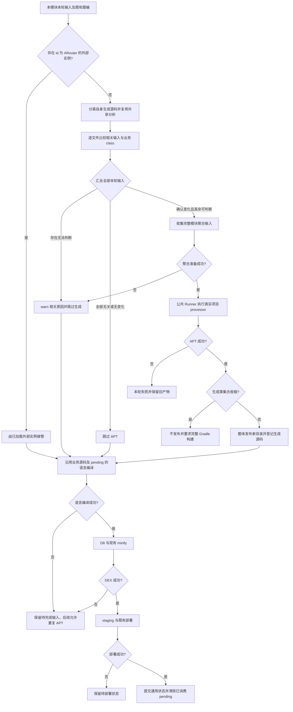
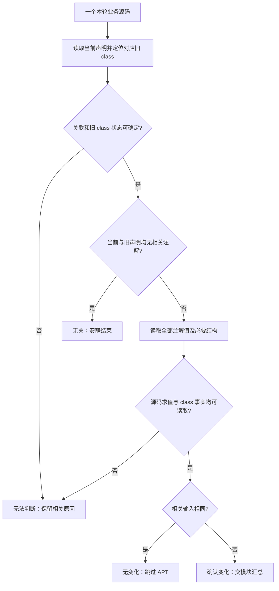
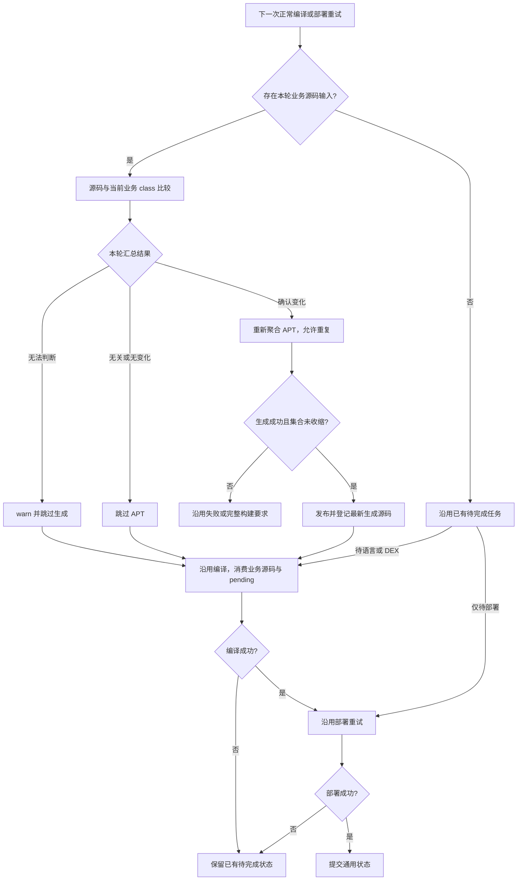

# ARouter 基于业务 class 的输入比较方案

日期：2026-10-13。状态：生产实现已完成，定向验证已完成；设备部署未验证。

本方案由原无输入 record 稿重写并重命名，以本轮用户澄清为准：比较当前源码与对应业务 class 的相关输入，不保存输入 record，不反向解析 APT 生成效果；接受语言编译失败后重试时重复 APT，以及检测跳过后业务 class 更新导致的索引滞后边界。本轮已按本文实现生产代码；实际改动和验证记录见第 9 节。

原处理器能力层方案继续作为现有实现的历史说明；其中依赖输入 record、固定生成模板、不同输入但输出相同就跳过 APT，以及失败重试不重复 APT 的要求，由本文替代。

## 1. 问题与已确认取舍

本轮解决定制 ARouter 契约被拒绝、普通页面被卷入模块级基线告警，以及输入 record 与产物重复维护的问题。

| 已确认现象或要求 | 原因或边界 | 本方案处理 |
|---|---|---|
| fixture 报 Unknown ARouter annotation contract Route | Route 增加 app，现实现要求属性集合等于固定 SCHEMA | 按实际注解定义读取全部属性及默认值，app 自然参与比较 |
| fixture 生成八参数 RouteMeta.build | 现有基线恢复硬编码官方七参数描述符及参数位置 | 删除生成模板前置验证，不以参数数量决定能否调用通用 APT/KAPT |
| MainActivity 单独编译也出现 overlay 基线告警 | 无 record 时在判断文件是否有关之前拒绝模块 overlay | 先关联当前与旧声明，删除 overlay 门禁 |
| 不能只比较 Route 参数 | 字段类型、类身份、继承和接口关系也可能影响生成 | 比较相关注解及被注解声明的必要结构 |
| 不再保存输入 record | 用户已确认以现有业务 class 作为输入比较基线 | 删除输入摘要、环境摘要及生成物绑定签名 |
| APT 成功后语言编译失败 | class 可能仍旧或部分更新，重试会再次发现差异 | 允许重复 APT，保留已有 pending 跟踪 |
| 检测跳过后普通编译成功 | class 可能已新，生成索引仍旧 | 告警说明索引可能滞后，不承诺下一轮自动修复 |

MainActivity 的普通 ARouter runtime import 不等于有 ARouter 注解。只有当前或对应旧业务 class 存在相关注解贡献时，才进入相关输入比较；普通方法体、注释和格式不参与比较。

Java 普通编译会把输出复制到 javaClassPath；Kotlin 普通编译使用 kotlinClassPath。因此，本方案读取的是现有编译链维护的业务 class，不将其称为“仅保留完整 Gradle 构建时的旧 class”。这些 class、APT 生成源码和设备部署进度不是同时提交的事务；本文接受下述失败边界，不新增版本记录来证明它们属于同一轮。

## 2. 删除与保留范围

删除 ARouter 专用的以下职责：

- inputs.json，包括逐源码路径、身份、语义摘要、environment 和格式迁移。
- checkpoint.txt 的输入签名、生成文件持久化清单及绑定校验。
- 从生成源码或生成 class 反向恢复历史输入、校验全模块 class 与 generated 一致的链路。
- Route 固定属性集合、RouteMeta.build 固定描述符及七／八参数模板检查。
- 基于模块或依赖 overlay 的检测门禁。

保留以下真实产物和既有机制：

- 最新完整生成源码目录、APT 临时输出，以及成功后整体替换生成目录的发布操作。
- 既有 changed / compiled / staging / deployed 跟踪和 SourceCompiler 对生成源码的登记。
- 共享 AptSourceAnalysis、源码值及类型解析、ConstRef 和既有结构影响传播。
- 项目 processor 发现、选项透传、Fragment / Jetifier 兼容、公共 AnnotationProcessorRunner。
- 同 id 外部 ARouter 处理器优先规则。
- Jetifier 转换 JAR 的缓存 key；它不承担输入基线职责。

不新增输入数据库、跨轮内存快照、业务 class 副本、部署版本映射或缓存框架。本轮查询和解析结果随当前分析轮次结束。GeneratedSourceCheckpoint 是否还保留少量发布实现按实际调用决定；ARouter 不再调用记录读写接口，不影响无关消费者。

已有 inputs.json / checkpoint.txt 不参与判断，不做 v2 / v3 迁移。新生成成功后可清理该 ARouter 目录内的旧元数据；删除这些文件不再导致告警，也不决定 APT 是否执行。

### 2.1 默认通用实现与定制扩展

本通用方案让已支持的 ARouter 工程无需专用 CustomCompiler 适配器，同时保留既有外部处理器接管能力。默认实现无法覆盖的工程，可以通过 CustomCompiler 加载定制实例；没有该实例时，直接使用默认通用流程。

| 名称 | 实际职责 | 本方案处理 |
|---|---|---|
| ARouterJuggAptProcessor | Jugg 自带的分析与编排实现，由 ProcessorRegistration.get() 注册 | 默认使用；存在已加载的同 id 外部实例时沿用避让逻辑 |
| 项目 ARouter annotation processor JAR | 项目依赖中的真实 JSR 269 处理器，实现 Route / Autowired 等代码生成 | 继续由公共 Runner 发现并执行，包含本次 fixture |
| ARouter CustomCompiler 适配器 | 通过 CustomCompilerManager 的 ICompilerCreator SPI 加载，同时实现 IJuggAptProcessor | 作为可选定制扩展保留；通用实现能够覆盖的工程无需配置 |

避让条件保持为：context.customCompilers 中存在实现 IJuggAptProcessor 且 id == "ARouter" 的已加载实例。满足时默认实例返回空列表，随后 JuggAptCompiler 执行外部实例。仅有配置但未成功加载不满足条件；该规则不按 ARouter 版本、标准版或 fork 分派。

该选择只决定哪个实现负责 ARouter。外部实例沿用自身生成与 failClosed 契约，不再叠加默认生成；其他 CustomCompiler 保持原流程。本轮不修改应用配置，不新增开关、优先级或公共扩展接口。

## 3. 比较规则：相关输入与业务 class

核心规则：**当前相关输入与对应业务 class 中的输入不同，才触发聚合 APT；输入相同则跳过。** 不计算当前预期输出，不读取生成索引的方法指令，不检查 RouteMeta.build 参数数量。

### 3.1 比较内容

| 对象 | 比较范围 |
|---|---|
| 注解 | 注解类型、声明归属及全部实际属性值；两侧补齐实际定义中的默认值 |
| Route | 目标类身份、注解参数，以及影响路由分类的必要继承／接口关系 |
| Provider | 目标身份、相关接口注册关系及 Route 输入 |
| Interceptor | 目标身份、注解参数及必要接口关系 |
| Autowired | 字段身份、字段类型及有关泛型、全部注解参数、影响注入的宿主关系 |
| 路由参数 | 实际参与的本类及继承 Autowired 字段输入 |

注解参数按实际定义枚举，不设置固定属性数量白名单。源码常量先求值，字面量与同值常量、显式与隐式默认值、alias 与全限定名归一化；不把表达式文本差异或属性顺序当作变化。无法解析的值不能伪装成空值或相等。

比较采用相关输入语义，不比较整个源码或所有 class 成员。普通方法体、注释、格式、无关成员和未改变解析结果的 import 不触发 APT。源码与 class 的类型视图须分别读取；不能只比较父类名称，或用当前源码关系补造旧关系。继承字段及类型跟编必须通过真实 Flow 验证，不能仅以“复用已有传播”作为正确性证据。

全部注解属性参与比较，包括 name / desc。输入变化即使最终输出恰好相同，也允许执行 APT；不再根据文档开关忽略说明属性，不再保证不同输入但输出相同的情况跳过 APT。processor 仍负责 group、app 等参数的输出规则，Jugg 不复制这些生成规则。

标准 ARouter 和本次 fixture 必须验证；其他契约只要能按上述规则读取注解和相关结构，就不因属性增加或输出模板不同被拒绝。未知源码表达式、无法读取的旧注解或声明关联歧义，仍进入无法判断；本文不承诺任意 fork 的新增结构依赖都自动被识别。

### 3.2 单文件关联与旧 class 缺失

只消费本模块本轮业务源码和已有影响分析加入的跟编文件，排除自身生成源码。按当前声明身份精确定位对应 class；必要时利用现有 class 的 SourceFile、包名及声明身份恢复同文件多类、嵌套类、改名或移动前的关联。

当前和旧声明均无相关注解输入时安静跳过。当前已删除最后一个注解或 import，但对应旧 class 仍有注解时，比较删除效果。不能根据普通 runtime import 判定相关，也不能在关联前执行全模块契约检查。

区分“证明是新增声明，没有旧 class”与“本应有旧 class，但未找到或无法读取”。前者以空旧贡献比较；后者对受影响声明返回无法判断。归属有歧义时不伪造空旧输入。优先复用已有 class 查找和源码映射，不在检测阶段遍历模块业务源码，不解析生成模板来补关联。

## 4. 业务步骤与产物发布

### 4.1 文件结果与模块汇总

| 文件结果 | 含义 | 模块处理 |
|---|---|---|
| 无关 | 当前及旧声明均无相关输入 | 不运行 APT，不告警 |
| 无变化 | 当前相关输入与业务 class 中的输入一致 | 不运行 APT；已有 pending 继续正常流程 |
| 确认变化 | 可确定输入新增、删除或值／结构变化 | 本轮相关输入均可判断时，执行一次完整聚合 APT |
| 无法判断 | 相关输入不能读取、求值或可靠关联 | warn 指明相关文件和原因，本模块本轮跳过 ARouter，普通编译继续 |

不能找到首个变化就提前结束其他本轮输入检查。确认变化与无法判断同时存在时，以无法判断为准；完整聚合输入准备失败也按检测失败收口。真正 processor 执行失败保持 failClosed，不继续普通语言编译。

### 4.2 生成、发布与下游消费

只有确认变化后才收集完整模块 Java / Kotlin 聚合输入，执行现有公共 Runner，在临时目录生成完整产物。生成失败不覆盖旧目录。

旧生成类清单直接从真实目录读取：存在 Jugg 发布目录时使用它；尚无该目录时使用工程模型提供的 Gradle 生成目录。该选择仅用于收缩检查，不作为输入比较基线。Jugg 目录存在但为空，不因缺少 record 而回退原 Gradle 目录；目录不可读取时明确失败，不当作空清单。完整构建初始化会清空 compileRootDir，随后沿用新 Gradle 产物。

成功后比较旧、新生成 Java 类集合，出现收缩沿用完整 Gradle 构建要求，不发布新集合；其余情况整体替换生成目录并向 SourceCompiler 登记。无需持久化文件清单，也无需解析源码内容或 RouteMeta 调用。

后续沿用 Kotlin → Java → D8 / minify → staging → 部署和既有索引重启策略。无变化不重新返回已消费的全部生成源码；已有待完成源码继续进入正常编译。重复 APT 时重新登记最新产物，不能因已有 pending 而跳过新的相关输入，也不能遗漏新生成源码。

### 4.3 混合源码生成边界修复

2026-10-13 的真实工程验证发现：完整 Kotlin 聚合的 stub 不能交给普通 javac，否则 Kotlin typealias 的 import 会被当成缺失 Java class。含 Kotlin 的模块改用 KAPT `stubsAndApt`，完整业务 Java/Kotlin 文件显式传入，并且只指定实际 ARouter processor；纯 Java 模块沿用 `javac -proc:only`。不恢复旧 custom compiler 的注解文件筛选，以保留未编译新 Kotlin 依赖的解析能力。生成目录发布、failClosed 和 pending 契约保持不变，详见[原生 KAPT 修复方案](./arouter_native_kapt_generation_fix.md)。

## 5. 失败、重试与接受的边界

| 场景 | 产物状态 | 下一轮行为 |
|---|---|---|
| 检测跳过，普通语言编译成功 | 业务 class 可已新，索引仍旧 | 源码与 class 可能相同，接受不自动修复；告警不能声称索引已更新 |
| 真正 APT 执行失败 | 不发布新生成目录，也不继续普通编译 | 保留失败；后续正常重试再次比较输入 |
| 新生成集合收缩 | 不发布新集合 | 沿用完整 Gradle 构建要求 |
| APT 成功，语言编译失败 | 最新生成源码已发布，class 可旧或部分新 | 保留 pending；仍有输入差异时允许再次聚合 APT |
| D8 失败 | 已完成的语言 class 和生成物保留 | 输入相同则不 APT，沿用现有 DEX 重试 |
| 部署失败 | 已编译产物和 staging 保留 | 沿用部署重试，不以设备旧版本否定业务 class |
| 重试前再次修改路由 | 以新源码与当前业务 class 比较 | 有差异则重新聚合生成，登记最新产物 |

用户已明确接受失败重试时重复 APT。本方案不保证一次成功 APT 后的重试零新增 APT，不以 record、输入快照或生成模板解析实现这项优化。允许重复指下一次正常编译请求中的重新执行，不增加同轮自动循环或无界重试。

检测失败后的 warn 须说明“本模块本轮跳过生成，索引可能滞后”。若普通编译随后更新了业务 class，不保证修复检测条件后仅重试原输入即可补生成；恢复到一致状态可使用完整 Gradle 构建。这是已接受的 Best-effort 边界，不将检测失败自动升级为全轮失败或强制回退。

不新增后台全模块修复扫描。已有 pending 只负责产物后续消费，不证明业务 class 与成功 APT 同轮，也不作为跳过新输入比较的依据。

## 6. 实施范围与验收

实现集中在 ARouter 相关输入提取、对应 class 读取和生成目录发布；保留统一四参数 IJuggAptProcessor.process、共享分析、SourceCompiler 及外部处理器调用契约。Kuikly 保持只追加缺失注册的现有行为，不扩展删除和替换。

processor JAR、annotation / runtime 依赖及选项变化交给已有工程模型和 Gradle 完整构建，不保留 environment 摘要，也不额外检测上游未发现的原地 JAR 替换。旧磁盘元数据停用与旧二进制兼容是不同问题；本轮不恢复旧 Options ABI 或三参数 SPI。

按 06_testing.md 先保存真实失败证据，复用 ARouter / JuggApt owner 的有价值行为回归；编排必须有既有等价 Flow。调整依赖输入 record、输出同值或失败重试零 APT 的旧断言，不删除共享分析、正常生成、完整聚合、failClosed 和 pending 消费保护。

| 场景 | 预期结果 |
|---|---|
| 官方版与本次 fixture，修改 path 或 app | 默认入口使用项目 processor 成功生成，无固定属性或七／八参数门禁 |
| MainActivity 只有 runtime import，已有 overlay，连续修改方法体 | 无 ARouter APT 或基线告警 |
| 路由类连续 100 次仅修改方法体 | 零新增 APT，核对检测成本 |
| 同值常量、显式默认值、alias 和属性顺序变化 | 相关输入相同，不 APT |
| 注解参数变化但实际输出恰好相同 | 允许执行 APT |
| 字段类型、泛型、路由分类或 Provider 接口关系变化 | 正确触发；包含父类变化后的真实跟编 Flow |
| 常量变化，使用方源码文本不变 | ConstRef 送入使用方，求值后与 class 注解值不同则触发 |
| 检测跳过后 class 已新、索引仍旧 | 保留明确告警，记录不保证自动修复的边界 |
| APT 失败 | 保留异常和旧目录，不继续业务源码编译 |
| APT 成功后 Java 失败，或 Kotlin 成功而 Java 失败 | pending 保留，允许重复 APT，修复后编译完成且消费最新产物 |
| D8 / 部署失败后输入相同 | 沿用既有重试，不为补下游阶段执行 APT |
| pending 存在时又修改路由 | 新输入重新比较，不因 pending 丢弃变化 |
| 删除最后一个注解和 import；改名、多类、嵌套类、同名 SourceFile | 可关联时比较新增／删除；歧义时明确告警，收缩沿用完整构建要求 |
| 相关不可解析输入与普通文件同轮 | 不发布部分索引，告警只列相关失败原因 |
| 删除旧 inputs.json / checkpoint.txt，完整构建后再增量 | 不因元数据缺失失败，读取当前业务 class |
| 同 id 外部 IJuggAptProcessor 已加载 | 默认实例避让；其他 id 或仅配置未加载不触发避让 |

以上验收已按第 9 节的实际用例执行；设备部署和完整 IDE Run 未验证。知识库及受影响的中英文 Wiki 已同步当前实现。

## 7. 业务流程图

### 7.1 主流程：输入比较 → 生成 → 编译 → 部署



外部实例沿用自身 failClosed 契约。检测跳过后普通编译成功可能使 class 与索引不同步，图中不增加自动修复分支。

### 7.2 单文件：关联声明并比较输入



已证明的新增声明以空旧贡献比较；本应有 class 却未找到不能当作新增。比较不读取生成索引内容，overlay 不参与判断。

### 7.3 失败后重试：允许重复 APT 并保留 pending



该图不新增调度器。新业务源码输入仍先进入正常编译；旧 staging 或 pending 不能代替新输入比较。检测跳过后源码与 class 相同，可走跳过 APT 分支，即使旧索引仍滞后，这是本文明确接受的边界。

## 8. 实现依据

- [现有能力层方案：输入记录保留范围](arouter_processor_capability_refactor_plan.md)
- [ARouterInputSemantics：实际注解定义与相关结构比较](../../../main/src/main/java/com/sickworm/intellij/jugg/compiler/source/apt/processors/ARouterInputSemantics.kt)
- [ARouterBaseline：业务 class 及 SourceFile 关联](../../../main/src/main/java/com/sickworm/intellij/jugg/compiler/source/apt/processors/ARouterBaseline.kt)
- [ARouterJuggAptProcessor：外部避让、检测收口及生成发布](../../../main/src/main/java/com/sickworm/intellij/jugg/compiler/source/apt/processors/ARouterJuggAptProcessor.kt)
- [JuggAptCompiler：外部发现和 failClosed](../../../main/src/main/java/com/sickworm/intellij/jugg/compiler/source/apt/JuggAptCompiler.kt)
- [JavaCompilerInvoker：普通编译更新 classpath](../../../main/src/main/java/com/sickworm/intellij/jugg/compiler/source/JavaCompilerInvoker.kt)
- [KotlinCompilerInvoker：普通编译输出目录](../../../main/src/main/java/com/sickworm/intellij/jugg/compiler/source/kotlin/KotlinCompilerInvoker.kt)
- [SourceCompiler：阶段顺序及生成源码跟踪](../../../main/src/main/java/com/sickworm/intellij/jugg/compiler/source/SourceCompiler.kt)
- [现有 ARouter 行为和 pending 回归 owner](../../../main/src/test/java/com/sickworm/intellij/jugg/compiler/source/apt/ARouterJuggAptProcessorTest.kt)
- [JuggManager：完整构建初始化](../../../idea/src/main/java/com/sickworm/intellij/jugg/JuggManager.kt)
- [测试与验证细则](../../ai_knowledge/06_testing.md)

方案原始现场依据为此前核对的 fixture 注解 JAR、生成路由表及 Demo 2026-10-13 09:12 的检测异常。本轮实现依据的复验记录见第 9 节。方案选择以用户随后明确接受的输入比较、失败滞后和重复 APT 取舍为准，不将原稿的输出效果比较作为实施要求。

## 9. 实施与验证记录

### 9.1 实际实现

- 删除 ARouter 的 inputs.json 读写、输入/环境摘要、checkpoint 签名、格式迁移、生成模板反向恢复和 overlay 门禁。`GeneratedSourceCheckpoint` 只保留完整源码目录发布及 Jetifier JAR 哈希；旧元数据不参与判断，成功发布后尽力清理。
- 全部实际注解属性和默认值参与比较，不再忽略 name/desc，不再复制 group/name 的输出推导规则。保留共享源码/常量/类型解析、官方和定制 processor 发现、四参数 SPI、Fragment/Jetifier 和外部同 id 已加载实例的避让规则。
- 每个输入先关联本模块业务 class，查询与解析缓存只活一轮。逐文件完整汇总，任一相关输入不能判断则 warn 并跳过本模块生成。聚合分析失败只记录相关失败文件；真实 processor 失败继续 failClosed。
- 旧生成类集合直接读取 Jugg 发布目录，存在但为空也不回退 Gradle；无 Jugg 目录才使用模型中的 Gradle 目录。收缩保持旧目录并要求完整 Gradle 构建。Jugg 专用目录包含的全部 Java 文件都参与检查，包括不含 ARouter 的辅助类名；共享 Gradle 目录沿用 ARouter 文件命名识别，以隔离其他注解器产物。
- 一个需要补充明确的时序点：仅等现有跟编送入子类，可能已失去旧父类关系。真实 Flow 先证明父类 class 更新后比较子类会漏检，因此父类关系变化轮次利用现有业务 class 定位已知相关注解声明，在覆盖父类 class 前按名称读取源码并比较。不扫描业务源码目录、不保存新的依赖图或跨轮快照；现有结构传播和子类语言编译继续执行。

### 9.2 验证范围

测试价值门禁通过：生成内容、是否执行真实 processor、完整聚合、failClosed、pending 消费以及编译后可加载的路由/参数结果均为稳定可观察行为。复用 `ARouterJuggAptProcessorTest` 和 `JuggAptCompilerTest`，不新增测试专用生产 seam；编排使用真实 SourceCompiler → Kotlin/Java → D8 的等价 Flow。

修复前已保存两个失败用例：name 变化被忽略；只有 runtime import 的普通 MainActivity 遇到 overlay 仍告警。父类关系 Flow 又确认旧父类 class 被覆盖后漏检分类变化的问题，随后针对这一边界修复。收尾回归又确认仅按 ARouter 文件名过滤会漏掉 Jugg 专用目录的辅助类收缩，已改为检查专用目录中的全部 Java 文件。

已执行覆盖：

- 官方 ARouter 1.5.2，以及本地真实 `app`/八参数定制 fixture。fixture 使用默认入口生成，修改 app，再修改 path，经 Java/D8 编译并加载实际 `com.tencent.yb.routes` 索引验证新路由；不加载 fixture 的自定义适配器。
- Java 方法体连续 100 次变化零新增 APT；同值常量、显式默认值、属性顺序、Kotlin alias/全限定名等价写法；name 输入变化即使输出相同也执行 APT。
- ConstRef 送入源码文本未变的使用方、父类分类变化、继承 Autowired 字段类型变化的真实 Flow；Provider 接口变化验证实际注册 key，Autowired 泛型变化验证擦除类型相同仍重新生成；生成 DEX 后加载路由与参数集合。
- 完整聚合失败不发布部分索引；真实 processor 失败、生成类收缩、直接生成源码语言错误；同文件多类、嵌套类、源码移动、同名 SourceFile 跨包歧义、最后一个注解/import 删除；已知 APK 声明缺 class 不能当新增。
- APT 后 Java 失败、Kotlin 成功而 Java 失败；pending 下再次修改路由、允许重复 APT并消费最新产物；语言 class 已更新后 D8 阶段失败，重试不再执行 APT。
- 删除或破坏旧元数据、生成源码内容不充当输入基线、完整构建初始化清空增量目录、已有空 Jugg 目录不借用 Gradle 生成清单；外部已加载同 id 处理器接管；Jugg 专用目录中非 ARouter 命名辅助 Java 类删除仍触发收缩保护。

真实 fixture 测试要求 `JUGG_AROUTER_FIXTURE` 指向含 arouter-compiler.jar、arouter-annotation.jar、arouter-api-release.aar 和 processor-deps 的目录；未提供时只跳过该 fixture 用例，不伪造官方用例为定制验证。本轮使用 `/Users/wormchen/IdeaProjects/demo/aigc-bot-client/arouter-fixture`，fixture 用例实际执行。

最终定向命令（JBR 17、Android SDK platform 30）：

```bash
JAVA_HOME=/Users/wormchen/Library/Java/JavaVirtualMachines/jbr-17.0.12/Contents/Home \
ANDROID_HOME=/Users/wormchen/Library/Android/sdk \
JUGG_AROUTER_FIXTURE=/Users/wormchen/IdeaProjects/demo/aigc-bot-client/arouter-fixture \
./gradlew :main:test --tests '*ARouterJuggAptProcessorTest' --tests '*JuggAptCompilerTest' :idea:compileKotlin
```

此前默认 Zulu JDK 21 下，仓库旧 D8 在 JVMTI `ViewHierarchyServer$1.class` 打包时抛出 NPE，尚未进入测试。中间验证使用已有 runtime/instruments 产物跳过相应打包任务；改用 JBR 17 后 `:jvmti_agent:buildInstrumentJar` 已成功，最终命令不排除任何任务。

成本样本：JBR 17、SDK 30、本地临时 Java fixture 下，最终 100 次方法体编辑与输入比较共 381 ms（含写文件，约 3.81 ms/次），真实 processor 调用次数不变。该单轮样本用于核对检测成本，不是大型模块或冷磁盘性能承诺。

设备部署失败/重试、完整 IDE Run 和所有 fork 的结构依赖没有在本轮做真机验收；不据此宣称设备端已验证。检测跳过后 class 更新导致索引滞后仍是已接受的边界，完整 Gradle 构建可恢复一致状态。

### 📋 本次执行清单

- 依据：AGENTS.md；知识库 00_overview.md、99_index.md、98_code_map.md、02_compile_custom_ui.md、02_compile_source.md、06_testing.md、10_wiki_authoring.md、10_wiki_architecture.md；本方案和 .agents/skills/wiki-writer/SKILL.md；docs/wiki/zh/capabilities/compile/index.md、docs/wiki/zh/concepts/incremental-compile/custom-compiler.md，以及中英文 capabilities/compile/custom-compiler.md、capabilities/compile/annotation-processors.md；ARouter/JuggApt/SourceCompiler/DEX 实现、真实官方与定制 processor 产物和失败测试。
- 验证：上述行为 owner 的定向回归及真实编译 Flow、IDE 核心文件诊断、idea:compileKotlin、Wiki 镜像/链接检查和 production build；最终 73 条用例全部通过（ARouter owner 62、JuggApt owner 11），0 失败、0 跳过；idea:compileKotlin 和所有选中依赖构建任务通过，无任务排除。Wiki production build、镜像/链接/HTML 检查和 git diff --check 通过，IDE 核心文件诊断无错误。
- 文档：同步编译专题、代码地图及受影响的中英文 Wiki；记录父类比较时序和未执行的设备验收。
- 提交：仅提交本次实现、回归与文档，commit hash 和标题见本次对话结果。
